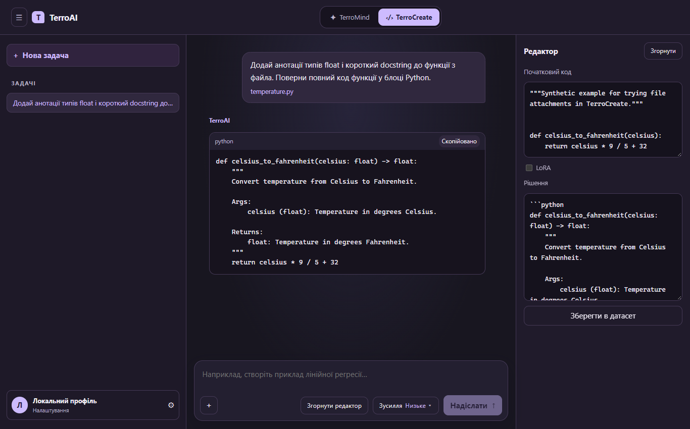

# TerroAI v0.1

TerroAI is a local AI assistant for Windows. **TerroMind** is for general chat. **TerroCreate** has a separate history, a code editor, and file attachments. Both use [Qwen/Qwen3-8B](https://huggingface.co/Qwen/Qwen3-8B) with 4-bit NF4 quantization. The interface is in Ukrainian.

## Install on Windows

Use Windows x64, Python 3.12 x64 with the Windows Python Launcher, an NVIDIA GPU with a driver compatible with CUDA 12.8, and about 25 GB of free disk space. TerroAI was tested on an RTX 3060 Ti with 8 GiB of VRAM. Available GPU memory depends on other running applications and prompt length. Run these commands in PowerShell from the repository root.

~~~powershell
py -3.12 -m venv .venv
.\.venv\Scripts\python.exe -m pip install --upgrade pip
.\.venv\Scripts\python.exe -m pip install "torch==2.8.0+cu128" --index-url https://download.pytorch.org/whl/cu128
.\.venv\Scripts\python.exe -m pip install -r requirements.txt
.\.venv\Scripts\python.exe -m pip check
.\.venv\Scripts\python.exe -c "import torch; print(torch.__version__, torch.cuda.is_available())"
~~~

The last command should print `2.8.0+cu128 True`. If it prints `False`, use `nvidia-smi` to check the driver and GPU. The CUDA wheel comes from the [official PyTorch index](https://pytorch.org/get-started/previous-versions/).

## Download and run

~~~powershell
.\.venv\Scripts\python.exe config.py --download
$env:QWEN_OFFLINE = "1"
.\.venv\Scripts\python.exe api_server.py --with-ui
~~~

Open [http://127.0.0.1:8001/ui/](http://127.0.0.1:8001/ui/). The first request loads the model onto the GPU and can take longer. The server binds to `127.0.0.1` and has no authentication, so keep it local. The OpenAI-compatible API base URL is `http://127.0.0.1:8001/v1`.

If port 8001 is already in use, choose another port. For the example below, open [http://127.0.0.1:8012/ui/](http://127.0.0.1:8012/ui/).

~~~powershell
.\.venv\Scripts\python.exe api_server.py --with-ui --port 8012
~~~

If another process already has Qwen loaded on the same GPU, free enough VRAM before starting generation. A different port does not free GPU memory.

Model weights and the tokenizer download separately into `.runtime/hub`. Set `$env:QWEN_OFFLINE = "1"` again in each new PowerShell session to use the cache. Before a new download, clear it with `Remove-Item Env:QWEN_OFFLINE -ErrorAction SilentlyContinue`. Use `QWEN_RUNTIME_DIR` to choose a different local cache directory. To reproduce the tested model revision, set `$env:QWEN_REVISION = "b968826d9c46dd6066d109eabc6255188de91218"` before downloading and running the model.

## Try it

1. In **TerroMind**, ask why the Moon has phases.
2. In **TerroCreate**, drop [temperature.py](examples/temperature.py) into the chat or input field, or select it with **+**. Ask TerroCreate to add type hints and a short docstring.
3. Send the message with **Надіслати**, then use **Копіювати** to copy the code block.

PNG, JPEG, and BMP photos are processed locally by Windows OCR, which requires an installed OCR language component. Qwen receives the recognized text rather than the image pixels. Chat history and drafts are stored in the browser's local storage. The standard setup requires no account or API key.

Optionally, run `dataset_manager.py seed` to add five synthetic examples to a local dataset. Run `train_lora.py` for local fine-tuning. Both commands have a `--help` option. The release excludes local datasets, model weights, adapters, logs, and chat history.

## License

TerroAI code, demo examples, and screenshots are available under the [MIT License](LICENSE). The [Qwen3-8B base model uses Apache 2.0](https://huggingface.co/Qwen/Qwen3-8B/blob/b968826d9c46dd6066d109eabc6255188de91218/LICENSE). See [THIRD_PARTY_NOTICES.md](THIRD_PARTY_NOTICES.md) for dependency licenses.
