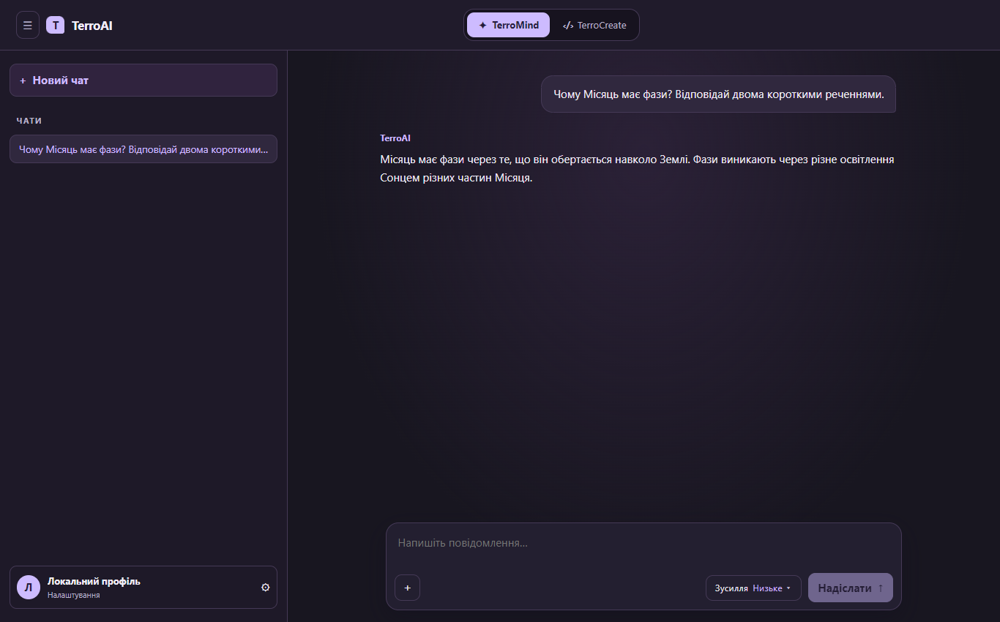

# TerroAI v0.1

TerroAI — локальний асистент із двома робочими просторами. **TerroMind** призначений для розмов. **TerroCreate** має окрему історію, редактор коду та вкладення. Обидва режими використовують базову модель [Qwen/Qwen3-8B](https://huggingface.co/Qwen/Qwen3-8B) у 4-бітному режимі NF4.




## Встановлення на Windows

Потрібні Windows x64, Python 3.12 x64 із Windows Python Launcher, GPU NVIDIA з драйвером для CUDA 12.8 і близько 25 ГБ вільного місця для залежностей і моделі. Перевірений запуск використовував RTX 3060 Ti з 8 ГіБ VRAM. На доступну пам’ять впливають інші програми та довжина запиту. Команди виконуйте в PowerShell із кореня репозиторію.

```powershell
py -3.12 -m venv .venv
.\.venv\Scripts\python.exe -m pip install --upgrade pip
.\.venv\Scripts\python.exe -m pip install "torch==2.8.0+cu128" --index-url https://download.pytorch.org/whl/cu128
.\.venv\Scripts\python.exe -m pip install -r requirements.txt
.\.venv\Scripts\python.exe -m pip check
.\.venv\Scripts\python.exe -c "import torch; print(torch.__version__, torch.cuda.is_available())"
```

Остання команда має показати `2.8.0+cu128 True`. Якщо показує `False`, перевірте драйвер і доступність GPU за допомогою `nvidia-smi`. Пакет CUDA встановлюється з [офіційного індексу PyTorch](https://pytorch.org/get-started/previous-versions/).

## Завантаження й запуск

```powershell
.\.venv\Scripts\python.exe config.py --download
$env:QWEN_OFFLINE = "1"
.\.venv\Scripts\python.exe api_server.py --with-ui
```

Відкрийте [http://127.0.0.1:8001/ui/](http://127.0.0.1:8001/ui/). Перший запит завантажує модель на GPU і може тривати довше. Сервер слухає лише `127.0.0.1`. Він не має автентифікації, тож залишайте його доступним лише локально. Якщо потрібен сумісний з OpenAI локальний API, його базова адреса — `http://127.0.0.1:8001/v1`.

Якщо порт 8001 зайнятий, запустіть сервер на іншому порту. Для прикладу нижче відкрийте [http://127.0.0.1:8012/ui/](http://127.0.0.1:8012/ui/).

```powershell
.\.venv\Scripts\python.exe api_server.py --with-ui --port 8012
```

Якщо інший процес уже завантажив Qwen на ту саму GPU, перед запуском нової генерації звільніть достатньо VRAM. Зміна порту не звільняє пам’ять моделі.

Ваги й токенізатор завантажуються окремо в `.runtime/hub`. У новому PowerShell знову виконайте `$env:QWEN_OFFLINE = "1"`, щоб працювати з кешем. Для нового завантаження спочатку виконайте `Remove-Item Env:QWEN_OFFLINE -ErrorAction SilentlyContinue`. Можна вказати інший локальний каталог кешу через `QWEN_RUNTIME_DIR`. Для повторення перевірки з тією самою ревізією Qwen задайте `$env:QWEN_REVISION = "b968826d9c46dd6066d109eabc6255188de91218"` перед завантаженням та запуском.

## Спробуйте

1. У **TerroMind** запитайте, чому Місяць має фази.
2. У **TerroCreate** перетягніть [temperature.py](examples/temperature.py) у чат або поле вводу. Можна також скористатися кнопкою **+**. Попросіть додати типи й короткий docstring до функції з файла.
3. Натисніть **Надіслати**, а після відповіді — **Копіювати** в її блоці коду.

Фото PNG, JPEG і BMP обробляються локально через Windows OCR. Потрібен встановлений мовний компонент розпізнавання. Qwen отримує розпізнаний текст, а не пікселі зображення. Історія та чернетки зберігаються в локальному сховищі браузера. Типовий запуск не потребує облікового запису чи API-ключа.

За бажанням `dataset_manager.py seed` додає п’ять синтетичних задач до локального датасету, а `train_lora.py` запускає локальне донавчання. Повні параметри доступні через `--help`. Датасети, ваги, адаптери, журнали й локальна історія не входять до релізу.

## Ліцензії

Код, демонстраційні приклади та скріншоти TerroAI поширюються за [ліцензією MIT](LICENSE). [Базова модель Qwen3-8B має окрему ліцензію Apache 2.0](https://huggingface.co/Qwen/Qwen3-8B/blob/b968826d9c46dd6066d109eabc6255188de91218/LICENSE). Відомості про залежності наведено у [THIRD_PARTY_NOTICES.md](THIRD_PARTY_NOTICES.md).
